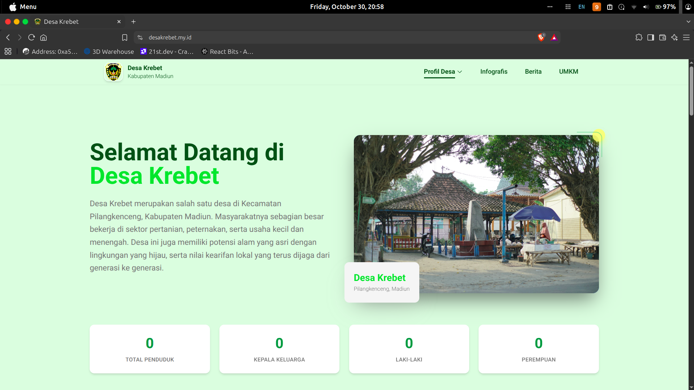
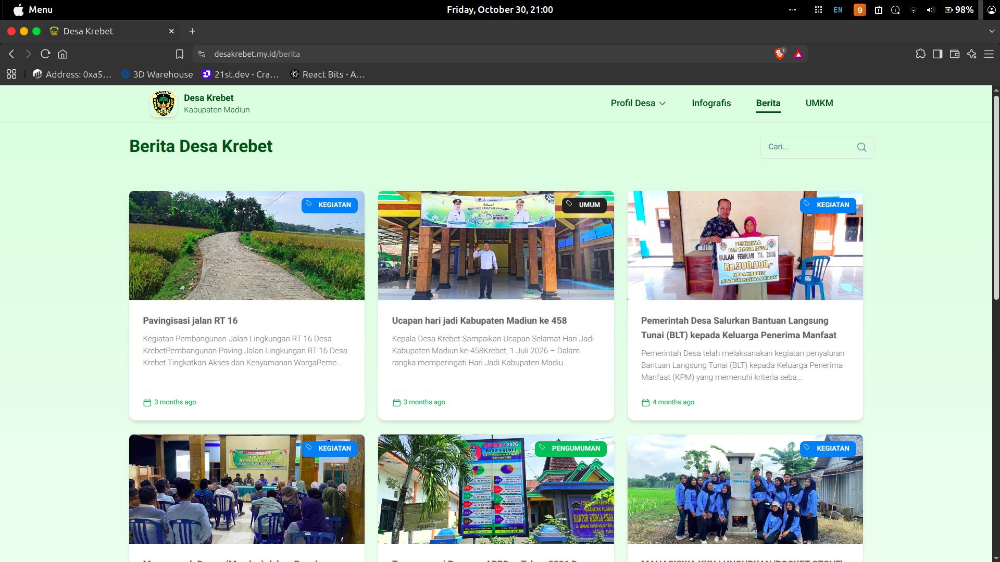
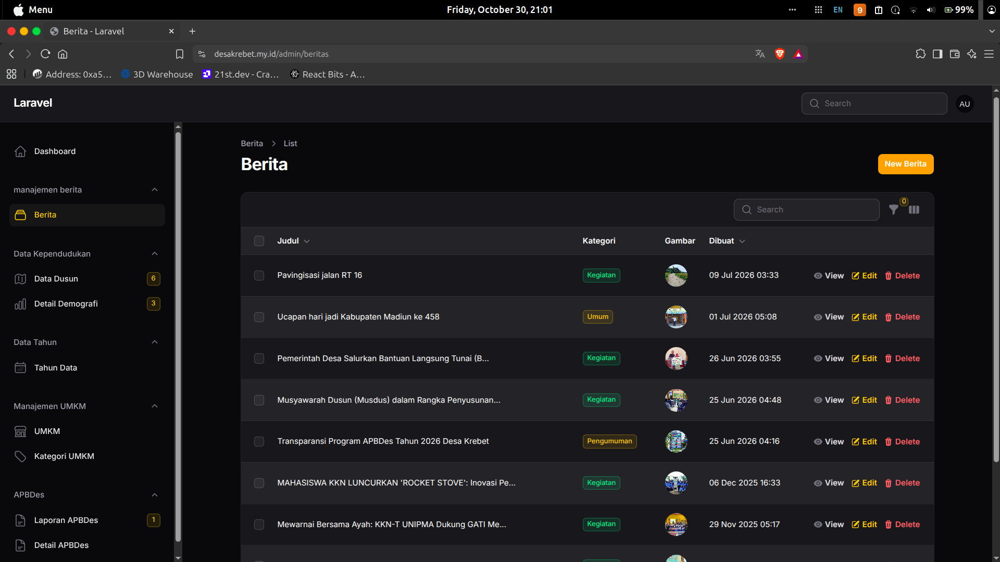

# 🌐 Web Desa Krebet — Frontend Portal Publik

[](https://react.dev/)
[](https://vitejs.dev/)
[](https://tailwindcss.com/)
[](https://www.material-tailwind.com/)
[](LICENSE)

Branch repositori khusus **Frontend Portal Publik** untuk Sistem Informasi Desa Krebet. Dibangun menggunakan **React JS**, **Vite**, dan **Tailwind CSS** sebagai antarmuka satu pintu yang menyajikan profil wilayah, warta berita, direktori UMKM lokal, serta visualisasi infografis transparansi APBDes dan kependudukan.

---

## 📸 Tampilan Antarmuka (Screenshots)

### 1. Landing Page (Hero Section & Ringkasan Statistik)
> *Menampilkan identitas visual desa, sambutan resmi, serta widget ringkasan statistik kependudukan (Total Penduduk, KK, Rasio Gender) yang diambil secara dinamis dari API backend.*



---

### 2. Laman Berita & Warta Desa
> *Katalog publikasi artikel, pengumuman, dan liputan kegiatan warga desa dilengkapi pencarian instan dan filter multi-kategori.*



---

### 3. Panel Manajemen Admin (Filament CMS)
> *Pratinjau antarmuka backoffice pengelola (berbasis Laravel + Filament PHP) yang mengelola konten berita, demografi dusun, produk UMKM, dan anggaran APBDes.*



---

## ✨ Fitur Utama Frontend

- **🏡 Landing Page Interaktif:**
  - Hero section responsif dengan live counter statistik kependudukan dari backend.
  - Seksi Sambutan Kepala Desa, Visi & Misi, dan Potensi Unggulan Desa Krebet.
  - Shortcut layanan publik desa, peta lokasi dusun, dan kontak resmi.
- **📰 Portal Berita & Pengumuman:**
  - Feed berita terbitan desa dengan badge kategori dan metadata tanggal.
  - Filter kategori dinamis (Kegiatan, Pembangunan, Pengumuman, dll).
  - Halaman detail berita dengan pelacak tayangan (*view counter*).
- **🏪 Direktori & Promosi UMKM Krebet:**
  - Katalog profil UMKM desa (kerajinan batik kayu, kuliner, agrikultur, jasa kreatif).
  - Halaman rincian profil usaha, etalase produk, dan tombol kontak WhatsApp langsung.
- **📊 Infografis & Visualisasi APBDes:**
  - Visualisasi grafik interaktif realisasi Pendapatan, Belanja, dan Pembiayaan Desa.
  - Diagram piramida penduduk dan perbandingan statistik demografi antar-dusun.

---

## 🛠️ Tech Stack & Dependensi

| Layer / Tool | Paket & Teknologi | Kegunaan |
|---|---|---|
| **Core Framework** | React JS (v18.2) | Library komponen UI reaktif |
| **Bundler / Server** | Vite (v4.5) | Fast build tool & local dev server |
| **Styling** | Tailwind CSS 3 & Material Tailwind | Utility CSS dan komponen desain material siap pakai |
| **Routing** | React Router DOM (v6.17) | Navigasi SPA (Single Page Application) |
| **API Client** | Axios | Request HTTP client ke backend Laravel API |
| **Charts** | ApexCharts & Chart.js | Visualisasi diagram batang, pie, dan piramida data |
| **Icons** | Heroicons & React Icons | Ikon antarmuka navigasi dan aksi |

---

## 📁 Struktur Direktori (Branch Frontend)

```text
.
├── public/                  # Aset statis (logo desa, favicon, gambar aset)
├── screenshots/             # Tangkapan layar antarmuka untuk dokumentasi
│   ├── hero-section.jpg     # Screenshot hero section landing page
│   ├── laman-berita.svg     # Screenshot laman berita
│   └── admin-panel.svg      # Screenshot admin panel
├── src/
│   ├── api/                 # Konfigurasi Axios instance & services API
│   │   └── services/        # Service modul: Berita, UMKM, Demografi, APBDes
│   ├── components/          # Komponen global (Navbar, Footer, ProtectedRoute)
│   ├── configs/             # Konfigurasi chart dan layout
│   ├── context/             # Global React state context
│   ├── hooks/               # Custom hooks data fetching (useStats, useBerita, dll)
│   ├── pages/
│   │   ├── landing/         # Komponen seksi Landing Page (Hero, Visi-Misi, Layanan)
│   │   ├── berita/          # Daftar berita dan halaman detail berita
│   │   ├── umkm/            # Direktori katalog dan halaman detail UMKM
│   │   ├── infografis/      # Grafik statistik APBDes & demografi penduduk
│   │   └── NotFound.jsx     # Halaman penanganan 404
│   ├── App.jsx              # Definisi rute React Router
│   └── main.jsx             # Entry point React
├── .env.example             # Template variabel lingkungan
├── tailwind.config.cjs      # Konfigurasi utility Tailwind
└── vite.config.js           # Konfigurasi build Vite
```

---

## 🚀 Panduan Instalasi & Menjalankan Aplikasi

### 1. Prasyarat Sistem
- **Node.js**: versi `18.x` atau lebih baru
- **Package Manager**: `npm` (disarankan), `yarn`, atau `pnpm`
- Backend Laravel berjalan di URL target (default: `http://localhost:8000`)

### 2. Kloning Branch Frontend
```bash
git clone -b frontend https://github.com/username-anda/web-desa-krebet.git
cd web-desa-krebet
```

### 3. Pasang Dependensi
```bash
npm install
```

### 4. Konfigurasi Variabel Lingkungan (.env)
Salin berkas template lingkungan:
```bash
cp .env.example .env
```

Sesuaikan URL endpoint REST API backend:
```env
VITE_API_BASE=http://localhost:8000/api
```

### 5. Jalankan Development Server
```bash
npm run dev
```
Buka browser pada alamat: `http://localhost:5173`.

### 6. Build Produksi
Untuk mengompilasi bundel produksi ke folder `dist/`:
```bash
npm run build
```

Pratinjau build produksi lokal:
```bash
npm run preview
```

---

## 🖼️ Memperbarui Berkas Screenshot
Untuk mengganti visual placeholder dengan tangkapan layar langsung aplikasi Anda:
1. Ambil screenshot halaman browser resolusi minimal `1920x1080` (rasio 16:9).
2. Simpan file ke dalam folder `screenshots/` dengan nama:
   - `hero-section.jpg` (atau `.png`)
   - `laman-berita.svg` (atau `.png`)
   - `admin-panel.svg` (atau `.png`)
3. Sesuaikan ekstensi file di file `README.md` ini bila menggunakan format lain.

---

## 📄 Lisensi
Didistribusikan di bawah lisensi **MIT**.
